## Beskrivning av datamodell för G

1. Utifrån verksamhetsbeskrivningen är den data vi behöver hålla koll på som egen sak personal, avdelningar och
   passerkort.  

2. Attribut vi behöver för personal är förnamn, efternamn, e-postadress, anställningsdatum och vilken avdelning
   personalen tillhör.  
   För varje avdelning behöver vi ett namn och en kontorsort.  
   Sist behöver vi passerkort med attributen kortnummer, utfärdande datum, sista giltighetsdatum och ett unikt fällt för
   vilken anställd kortet tillhör för att fastställa en anställd bara kan ha ett passerkort.  

3. Anställda och avdelningar har en till många koppling. Detta eftersom en avdelning kan ha flera anställda och en
   anställd har exakt en avdelning.    Passerkort och personal har valfri en till en koppling då varje kort
   tillhör exakt en anställd. Den är valfri eftersom en anställd inte behöver inneha ett passerkort.

---

## Modell till tabell G

### departments G

| Column     | Datatype | Key | Mandatory | Unique | Note |
|------------|----------|-----|-----------|--------|------|
| `id`       | INT      | PK  | Yes       | Yes    |      |
| `name`     | VARCHAR  |     | Yes       | No     |      |
| `location` | VARCHAR  |     | Yes       | No     |      |

### employees G

| Column          | Datatype | Key                    | Mandatory | Unique | Note                                        |
|-----------------|----------|------------------------|-----------|--------|---------------------------------------------|
| `id`            | INT      | PK                     | Yes       | Yes    |                                             |
| `first_name`    | VARCHAR  |                        | Yes       | No     |                                             |
| `last_name`     | VARCHAR  |                        | Yes       | No     |                                             |
| `email`         | VARCHAR  |                        | Yes       | Yes    | Två employees kan inte ha samma email       |
| `employed_at`   | DATE     |                        | No        | No     | Start datum                                 |
| `department_id` | INT      | FK → `departments(id)` | Yes       | No     | Varje employee tillhör alltid en department |

### access_cards G

| Column                | Datatype | Key                  | Mandatory | Unique | Note                                                             |
|-----------------------|----------|----------------------|-----------|--------|------------------------------------------------------------------|
| `card_number`         | INT      | PK                   | Yes       | Yes    | Identifierar kortet. Efter som PK så behöver vi ingen unique tag |
| `date_of_issue`       | DATE     |                      | Yes       | No     |                                                                  |
| `final_validity_date` | DATE     |                      | Yes       | No     |                                                                  |
| `employee_id`         | INT      | FK → `employees(id)` | Yes       | Yes    | Unique ser till att det finns max ett kort per employee          |

---

## G1. Anställda med avdelning

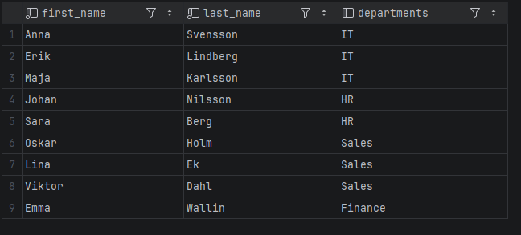

Här får man tillbaka `first_name`, `last_name` och `departments`. All data är populerade då samtliga kolumner har en
`NOT NULL`
flagg.

---

## G2. Avdelningar med anställda

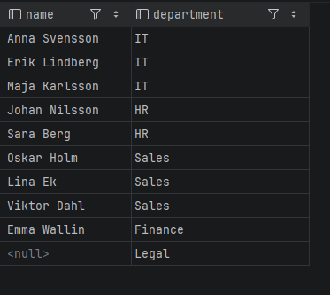

Här får vi tillbaka samtliga `department` fält. Om det finns fler än en anställd kopplad till en `department` så visas
samtliga. Om `department` inte har någon anställd kopplad till sig så retuneras fortfarande `department` men med ett
namn av
`NULL`. Detta sker efter som jag använder mig av left join vilket ser till att i det här fallet kommer datan från
`department` tabellen alltid att vara med vare sig den har någon koppling till en anställd eller ej.

Fältet `name` använder sig av `concat` för att addera `first_name` och `last_name` till ett fält istället för flera.

---

## G3. Java delens omfattning

`Access_cards`, `departments` och `employees` har fått en egen model klass.

Nedan går jag igenom hur varje fält i varje klass motsvarar en kolumn i databasen.

### Employee:

| Java Object  | Java Type    | DB column                | DB datatype                                      | Notes                                                                                                                                                                                                                                                                                                       |
|--------------|--------------|--------------------------|--------------------------------------------------|-------------------------------------------------------------------------------------------------------------------------------------------------------------------------------------------------------------------------------------------------------------------------------------------------------------|
| `id`         | `int`        | `id`                     | INT, PK                                          | Behöver inte använda `Integer` här eftersom `int` aldrig kommer vara `null`                                                                                                                                                                                                                                 |
| `firstName`  | `String`     | `first_name`             | VARCHAR(100)                                     |                                                                                                                                                                                                                                                                                                             |
| `lastName`   | `String`     | `last_name`              | VARCHAR(100)                                     |                                                                                                                                                                                                                                                                                                             |
| `email`      | `String`     | `email`                  | VARCHAR(255)                                     |                                                                                                                                                                                                                                                                                                             |
| `employedAt` | `LocalDate`  | `employed_at`            | DATE                                             |                                                                                                                                                                                                                                                                                                             |
| `department` | `Department` | `department_id`          | INT, FK > `departments(id)`                      | I Java har en employee en referens till ett `Department` objekt, eftersom anställda alltid måste tillhöra en `Department`. I databasen lagras kopplingen som en främmande nyckel istället.                                                                                                                  |
| `accessCard` | `AccessCard` | Ingen kolumn i employees | `access_cards.employee_id`, fk > `employees(id)` | I Java har employee klassen en potentiel referense till ett `AccessCard` objekt. Det är en valfri koppling så om objektet ger värdet `null` saknar den anställda ett acess card. I databasen ligger kopplingen på passerkortets sida men i Java ligger det som sagt istället som en referense i `Employee`. |

### Department:

| Java Object | Java Type | DB column  | DB datatype  | Notes                                                                       |
|-------------|-----------|------------|--------------|-----------------------------------------------------------------------------|
| `id`        | `int`     | `id`       | INT, PK      | Behöver inte använda `Integer` här eftersom `int` aldrig kommer vara `null` |
| `name`      | `String`  | `name`     | VARCHAR(100) |                                                                             |
| `location`  | `String`  | `location` | VARCHAR(100) |                                                                             |

### AccessCard:

| Java Object         | Java Type   | DB column             | DB datatype               | Notes                                                                                                                                                                                                         |
|---------------------|-------------|-----------------------|---------------------------|---------------------------------------------------------------------------------------------------------------------------------------------------------------------------------------------------------------|
| `cardNumber`        | `int`       | `card_number`         | INT, PK                   | Card number som pk ser dels till att vi inte kan duplicates samt aldrig ha ett `null` värde                                                                                                                   |
| `dateOfIssue`       | `LocalDate` | `date_of_issue`       | DATE                      |                                                                                                                                                                                                               |
| `finalValidityDate` | `LocalDate` | `final_validity_date` | DATE                      |                                                                                                                                                                                                               |
| inget värde         |             | `employee_id`         | INT, FK > `employees(id)` | Ingen referens till `Employee` i Java, eftersom kopplingen bara behövs i en riktning och `Employee` håller koll på referensen till `AcessCard`. Medan i databasen sker detta genom en FK mot ett employee id. |

---

## Output från main

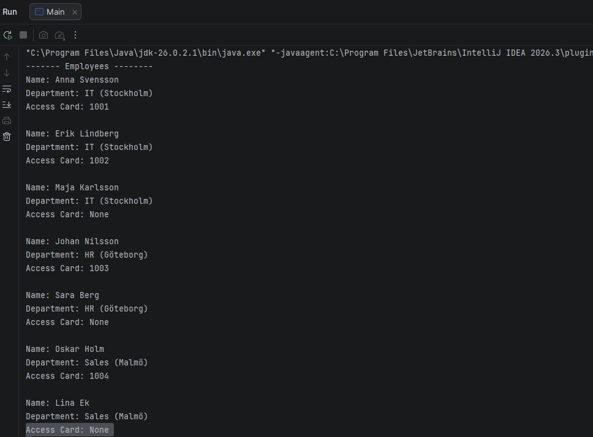

---

## Model för VG

1. Utifrån verksamhetsbeskrivningen till denna del så krävs det två delar. En för att hålla koll på kvalifikationer och
   en del för att sköta kopplingen mellan anställda och kvalifikationer.   

2. Attribut vi behöver för kvalifikationer är `id`, unikt namn och beskrivning. I join tabellen behöver vi attributen
   `employee_id` och `qualification_id` för att koppla samman datan.

3. Kvalifikationer och anställda har en många till många koppling. Då en kvalifikation kan finnas på flera anställda
   och en anställd kan ha flera kvalifikationer. Därför behövs ett join tabel som kopplar samman datan och
   samtidigt ser till att vi bara kan få unika kopplingar genom att sätta en PK med hjälp av `employee_id` och
   `qualification_id`

---

## Modell till tabell VG

### qualifications VG

| Column        | Datatype | Key | Mandatory | Unique | Note                                                                 |
|---------------|----------|-----|-----------|--------|----------------------------------------------------------------------|
| `id`          | INT      | PK  | Yes       | Yes    |                                                                      |
| `name`        | VARCHAR  |     | Yes       | Yes    | Unik så att vi inte har flera kvalifikationer med samma namn         |
| `description` | TEXT     |     | Yes       | No     | Ser till att varje kvalifikation alltid har någon typ av beskrivning |

### employee_qualifications (join table) VG

| Column             | Datatype | Key                                               | Mandatory | Unique                                  | Note                                                                              |
|--------------------|----------|---------------------------------------------------|-----------|-----------------------------------------|-----------------------------------------------------------------------------------|
| `employee_id`      | INT      | PK (del av sammansatt), FK > `employees(id)`      | Yes       | Yes/ tillsammans med `qualification_id` | En anställd kan ha flera kvalifikationer, så kolumnen är inte unik för sig        |
| `qualification_id` | INT      | PK (del av samansatt),  FK > `qualifications(id)` | Yes       | Yes/ tillsammans med `employee_id`      | En kvalifikation kan finnas hos flera anställda, så kolumnen är inte unik för sig |

Primärnyckeln är en kombination av `employee_id` och `qualification_id` vilket ser till att en anställd inte kan få
samma
kvalifikation mer än en gång.

---

## VG1. Anställda med avdelning och passerkort

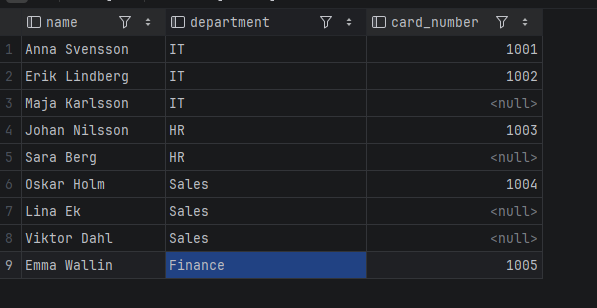

Här får vi tillbaka alla anställda med sin sammanlänkade `department`. Samt görs en left join på `access_cards` vilket
ger
oss kortnumret till dem anställda som har ett access card. Dem anställda som inte har ett access card kopplat returnerar
`null` istället. Detta som sagt eftersom vi använder oss av left join vilket alltid kommer joina den data som
möjligtvist
finns från höger men alltid behålla datan från vänstra sidan av joinen.

---

## VG2. Avdelningar med anställda och passerkort

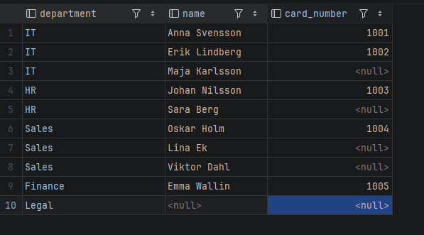

Frågan visar alla avdelningar samt deras anställdas namn. Den visar också eventuella kortnummer.

Alla rader i tabellen `departments` kommer alltid med, eftersom `departments` är den vänstra tabellen i LEFT JOIN.

Det är därför Legal får `NULL` i `name`: det finns inga anställda som tillhör den avdelningen.

Sedan görs en LEFT JOIN mot `access_cards`, baserat på den eventuella anställda som redan hämtats. Om den anställda har
ett passerkort visas kortnumret, annars `NULL`.

Det är därför flera anställda har `NULL` i `card_number`: de har inget passerkort. Legal får också `NULL` här, men av en
annan
anledning, eftersom det inte finns någon anställd att koppla ett kort till.

---

## VG3. En anställds samlade uppgifter

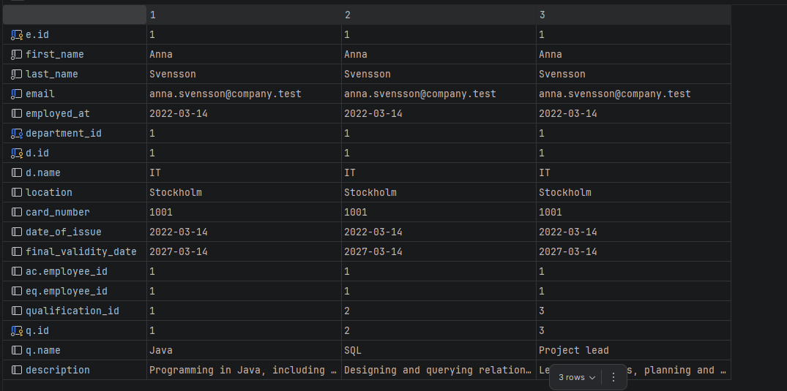

En anställd får flera rader här eftersom en anställd kan ha flera kopplingar i tabellen `employee_qualifications` (en
en-till-många-koppling). Varje koppling ger en egen resultatrad, och uppgifterna om den anställda, avdelningen och
passerkortet upprepas på varje rad. Anna har tre kvalifikationer och visas därför tre gånger.

Det är inte LEFT JOIN i sig som skapar flera rader, utan att det finns flera matchande rader i den högra tabellen. LEFT
JOIN ser bara till att anställda utan matchning också finns kvar.

`Departments` och `access_cards` ger aldrig extra rader, eftersom en anställd har exakt en avdelning och högst ett
passerkort (`UNIQUE` på `employee_id`). Om en anställd hade kunnat ha 2 passerkort och 3 kvalifikationer hade resultatet
blivit 2 × 3 = 6 rader, eftersom varje kort kombineras med varje kvalifikation.

---

## VG3. Kontroll av valfria kopplingar

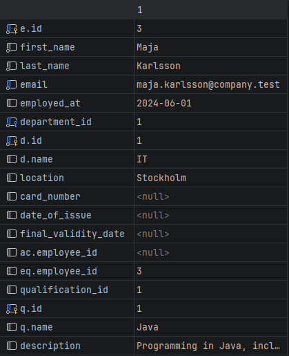

I bilden ovan är det en anställd som inte har ett `access_card`.
Eftersom jag använder mig av en LEFT JOIN så kommer employee datan alltid finnas. Alla `access_card` kolumner får ett
`null`
värde då det inte finns en koppling mellan dessa två. Qualifications får et värde eftersom denna anställda har en
koppling mellan dem två tabellerna.

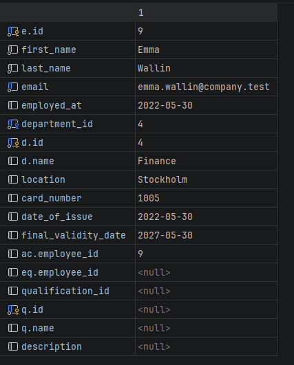

Av samma anledning som ovan kommer den anställdas data alltid att visas. Det enda som skiljer sig här är att Emma har en
koppling till ett `access_card` men ingen entry i vårat join tabel. Vilket gör att hon inte är länkad till någon slags
kvalifikation.

Så eftersom vi använder oss av left join så kommer alla kolumner som kommer från den högra sidan av våra joins fyllas
med data om en koppling finns med tabellen till vänster.

---

## VG4. Jämför INNER JOIN och LEFT JOIN

**Inner join:**

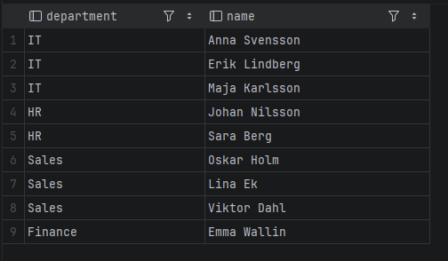

**Left join:**

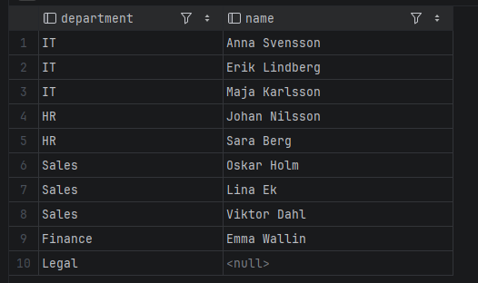

Legal försvinner i inner join eftersom det inte finns någon koppling vilket gör att `department` ignoreras eftersom den
inte fyller all data.

Den finns kvar vid left join eftersom att `department` är tabellen till vänster i min LEFT JOIN. Vilket gör att även om
den inte har någon employee som matchar så retuneras ändå datan från den vänstra sidan av tabellen. Vilket gör att
`name` i detta fall blir `NULL` för kolumnen namn när `department` är legal.

Sammanfattningsvis INNER JOIN = bara rader som matchar på båda sidor och LEFT JOIN = alla rader från den vänstra sidan
med `NULL` värden där den högra sidan inte matchar.

---

## VG5 Kompetenser i java-applikationen

I klassen `Employee` har jag lagt till en `List<Qualification>` som håller samtliga qualifications för en anställd.

Jag har också lagt till en metod `addQualification` som först kontrollerar att den tillagda kvalifikationen inte är
`null` och sedan att kvalifikationen inte redan finns i listan. Kontrollen fungerar i nuläget endast på objektidentitet.
Om det skapades ytterligare en qualification med `name` Java, fast med ett annat `id`, skulle den kunna läggas till.
Eftersom appen är så statisk som den är i nuläget, och varje qualification skapas en gång i `main`, finns det ingen
anledning att stoppa detta.

Till sist har jag lagt till en ny modellklass i projektet med namnet `Qualification`. Den består av ett id av typen
`int` och två `String`-fält, `name` och `description`.

Genom att skapa separata qualifications i `main` och sedan ge varje employee en lista av qualifications får vi en
många-till-många-koppling även i Java-projektet. Det beror på att en qualification kan tillhöra flera employees och en
employee kan ha flera qualifications.

### Qualification:

| Java Object   | Java Type | DB column     | DB datatype  | Notes                                                                                |
|---------------|-----------|---------------|--------------|--------------------------------------------------------------------------------------|
| `id`          | `int`     | `id`          | INT, PK      |                                                                                      |
| `name`        | `String`  | `name`        | VARCHAR(100) | Unikt i databasen (`UNIQUE`). I Java kontrolleras inte detta, se beskrivningen ovan. |
| `description` | `String`  | `description` | TEXT         |                                                                                      |

### Employee (tillägg för VG så hela employee klassen representeras ej):

| Java Object      | Java Type             | DB column                | DB datatype                                                   | Notes                                                                                                                                                                                     |
|------------------|-----------------------|--------------------------|---------------------------------------------------------------|-------------------------------------------------------------------------------------------------------------------------------------------------------------------------------------------|
| `qualifications` | `List<Qualification>` | Ingen kolumn i employees | `employee_qualifications` (`employee_id`, `qualification_id`) | I databasen ligger kopplingen i en JOIN TABLE. I Java håller `Employee` en lista med referenser till `Qualification`-objekt. `Qualification` har ingen referens tillbaka till `Employee`. |

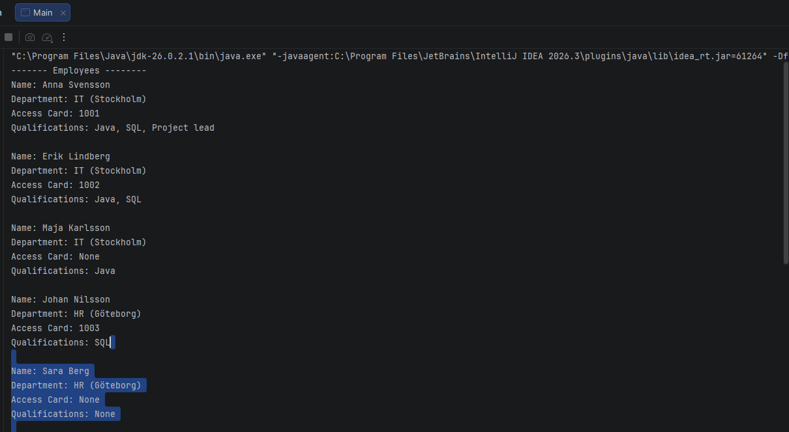

Output av main med vg ändringar.

---

## Starta java programmet

Kör `main` i klassen `Main`